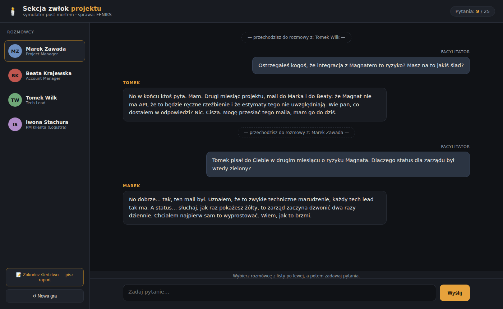

# Sekcja zwłok projektu

Narracyjna gra edukacyjna: wcielasz się w facylitatora post-mortem i przesłuchujesz AI odgrywające członków upadłego projektu. Uczy analizy przyczyn źródłowych, pytań otwartych i odróżniania faktów od narracji.



## Struktura repozytorium

- `sekcja-zwlok.html` — gra (jeden plik, zero backendu) z biblioteką 9 spraw w 3 domenach (projekty, bezpieczeństwo żywności, dane i RODO), wybieranych na ekranie startowym; scenariusze i silnik wstrzykuje do pliku `npm run build`. Obsługiwane silniki AI: Anthropic, OpenAI, GLM/Zhipu, DeepSeek, Groq (Llama) oraz lokalne: LM Studio, Ollama, llama.cpp i dowolny endpoint OpenAI-compatible. Ranking z autoryzacją mailową (tryb demo bez backendu), regulamin i polityka prywatności wbudowane.
- `ranking-server.js` — backend rankingu i pojedynków (Node.js + express + nodemailer): kody na email, maskowanie adresów (3 pierwsze + 3 ostatnie znaki), leaderboard, wyzwania. Konfiguracja w komentarzu na górze pliku.
- `test/` — testy `node:test` (bez zależności zewnętrznych): `npm test`.
- `docs/superpowers/specs/` — zatwierdzone specyfikacje funkcji.
- `system-prompt.md` — pełny prompt jednoplikowy (scenariusz FENIKS) do wklejenia w dowolny czat LLM.
- `gpt/` — źródło scenariuszy i pakiet Custom GPT: `gpt-master-prompt.md` (Instructions, <8000 znaków) + 9 scenariuszy (`scenariusz-NN-*.md`), talia modyfikatorów losowych i szablon scenariusza (pliki wiedzy). `gpt/silnik-gra.md` to prompt silnika używany w grze.
- `scripts/` — `scenariusze.js` (parser i walidator metadanych) oraz `build-scenariusze.js` (`npm run build`: wstrzykuje `SILNIK` i `SCENARIUSZE` do `sekcja-zwlok.html`).
- `img/` — grafiki w stylu polskiego komiksu kryminalnego lat 70. (opis niżej).
- `prompty-grafiki.md` — prompty do generatorów obrazu użyte do stworzenia grafik FENIKS.
- `prompty-grafiki-scenariusze.md` — prompty i lista plików grafik dla postaci pozostałych spraw.
- `koncept.md` — pełny koncept narzędzia (mechanika, analiza wartości, wnioski z iteracji, plan screencastu).
- `deck.js` + `sekcja-zwlok-prezentacja.pptx` — generator i gotowa prezentacja konceptu.

## Grafiki

| Ścieżka | Zawartość |
|---|---|
| `img/marek.png`, `beata.png`, `tomek.png`, `iwona.png` | Portrety czwórki przesłuchiwanych, 384×384. Gra podmienia nimi inicjały w panelu „Rozmówcy"; jeśli pliku brak, `onerror` cofa avatar do inicjałów. |
| `img/emocje/<postać>-<emocja>.jpg` | 20 wariantów mimiki, 768×768. Emocje: `radosc`, `zlosc`, `zaskoczenie`, `smutek`, `rezygnacja`. Wariant neutralny to portret główny z wiersza wyżej. Podmieniane w trakcie gry — patrz niżej. |
| `img/okladka.jpg` | Okładka „FENIKS — gra śledcza", 2:3. |
| `img/tlo-debriefu.jpg` | Ściana dowodów z czerwonymi sznurkami, 16:9. |

Grafiki w repozytorium są przeskalowane pod web. Oryginały 1254×1254 nie są wersjonowane — raster halftone kompresuje się fatalnie w PNG (~3,3 MB na plik).

## Scenariusze

Gra ma bibliotekę spraw, pogrupowaną na ekranie startowym według domen: 📁 Projekty (BILBORD, FENIKS, BLACKOUT, NOVA, PRZEJĘCIE, KONSORCJUM), 🍽️ Bezpieczeństwo żywności (CHŁODNIA 🇵🇱, SEZAM 🇬🇧), 🔐 Dane i RODO (WYCIEK 🇵🇱). Ostatni wybór pamięta `localStorage`, a link z wyzwaniem blokuje sprawę na tę z pojedynku.

Jak dodać sprawę:

1. Skopiuj `gpt/szablon-scenariusza.md` do `gpt/scenariusz-NN-nazwa.md`.
2. Wypełnij blok metadanych (YAML na początku pliku) i treść.
3. `npm run build` — waliduje metadane i wstrzykuje scenariusze do `sekcja-zwlok.html`.
4. `npm test` — test zawodzi, jeśli wstrzyknięty blok jest nieaktualny.

| Pole | Wartości | Rola |
|---|---|---|
| `id` | `[A-Z0-9_]{1,40}` | Klucz w rankingu i pojedynkach, niezmienny po publikacji. |
| `tytul` | tekst | Nagłówek karty sprawy i akt. |
| `domena` | `projekty`, `zywnosc`, `rodo` | Grupowanie na ekranie startowym. |
| `jurysdykcja` | `PL`, `UK`, `UE` | Flaga na karcie i ramy prawne w debriefie (`UE` bez flagi). |
| `poziom` | 1–5 | Od wprowadzającego do eksperckiego; sortowanie w domenie. |
| `pytania` | liczba | Budżet pytań. |
| `postacie[]` | `imie`, `nazwisko`, `rola`, `strategia`, `odmiana` | Rozmówcy; `odmiana` to formy imienia (pierwsza = mianownik), po których gra wykrywa konfrontację. |

**Źródła w scenariuszach branżowych.** Sekcja `ZASADY DO DEBRIEFU` przypisuje każdej przyczynie regułę wraz ze źródłem (akt prawny lub wytyczna urzędu, z linkiem). Debrief pokazuje je jako nieoceniany blok „Lekcja branżowa” — bez wpływu na punktację. Reguł nie wolno pisać z pamięci.

**Grafiki.** Portrety: `img/<slug(id)>/<slug(imię)>.png`, mimika: `img/<slug(id)>/emocje/<slug>-<emocja>.jpg` (slug = małe litery bez polskich znaków; FENIKS zachowuje stare ścieżki `img/*.png` i `img/emocje/*`). Brak pliku = fallback do inicjałów. Lista plików i prompty: [`prompty-grafiki-scenariusze.md`](prompty-grafiki-scenariusze.md). Wygenerowane obrazy wrzuć do dowolnego katalogu i uruchom `npm run grafiki -- <katalog>` — skrypt rozpozna sprawę, postać i emocję z nazwy pliku, przytnie, przeskaluje i zapisze pod właściwą ścieżką; `npm run grafiki -- --stan` pokazuje, czego brakuje (wymaga ImageMagick).

## Szybki start

Otwórz `sekcja-zwlok.html` w przeglądarce, wybierz silnik AI, wklej klucz (lub uruchom lokalny serwer modelu) i kliknij „Rozpocznij śledztwo".

Ranking ogólny: uruchom `ranking-server.js` i ustaw `RANKING_API` na początku skryptu w `sekcja-zwlok.html`. Wyniki konkretnej sprawy zwraca `GET /api/leaderboard?scenario=ID` (50 najlepszych; bez parametru — ranking ogólny), a modal rankingu w grze ma zakładkę dla każdej sprawy.

> **Uwaga:** grę i serwer rankingu aktualizuj razem. Starszy serwer ignoruje parametr `?scenario=` i w każdej zakładce wylistowałby wyniki ze wszystkich spraw.

```
npm install
SMTP_HOST=smtp.example.com SMTP_PORT=587 SMTP_USER=... SMTP_PASS=... \
MAIL_FROM="Sekcja Zwłok <ranking@example.com>" \
GAME_URL="https://twoja-domena/sekcja-zwlok.html" CHALLENGE_SALT="losowy-ciag" \
PORT=3001 npm start
```

Bez zmiennych SMTP serwer działa w trybie deweloperskim: treść maili i gotowe linki lądują na konsoli zamiast w skrzynkach. Pozwala to przejść cały przepływ lokalnie, łącznie z pojedynkiem, bez wysyłania czegokolwiek.

Dane trzyma SQLite (`node:sqlite` — wbudowany w Node 22+, bez zależności natywnych) w pliku `ranking.db` obok serwera. Plik jest celowo wykluczony z repozytorium: zawiera pełne adresy e-mail graczy. Kody autoryzacyjne, bilety i liczniki limitów też siedzą w bazie, więc **restart serwera nie kasuje aktywnych kodów ani nie resetuje ochrony przed spamem**.

Jeśli obok serwera leży `ranking-data.json` z poprzedniej wersji, przy pierwszym starcie zostaje przepisany do bazy i zmieniony na `ranking-data.json.migrated`. Operacja jest jednorazowa (warunek: pusta baza) i nieniszcząca — oryginał zostaje na dysku.

| Zmienna | Rola |
|---|---|
| `SMTP_*`, `MAIL_FROM` | Wysyłka maili. Brak = tryb deweloperski (konsola). |
| `GAME_URL` | Adres, pod którym stoi gra — potrzebny do zbudowania linku w zaproszeniu. **Brak wyłącza pojedynki.** |
| `CHALLENGE_SALT` | Sól do skrótów adresów przy limitowaniu zaproszeń. Brak = losowa przy starcie (limity resetują się po restarcie). |
| `CORS_ORIGIN` | Ograniczenie źródła żądań. Domyślnie `*`. |
| `DB_FILE` | Ścieżka bazy SQLite. Domyślnie `ranking.db` obok skryptu. |
| `DATA_FILE` | Ścieżka starego pliku JSON do jednorazowej migracji. Domyślnie `ranking-data.json`. |

## Emocje rozmówców

Przy każdej wypowiedzi w czacie pojawia się portret pokazujący, w jakim stanie jest postać w tej chwili — a portret w panelu bocznym odzwierciedla stan bieżący. Emocja przy dymku zostaje **zamrożona**, więc przewijając rozmowę widać przebieg przesłuchania: moment, w którym ktoś przestał się uśmiechać.

Emocji nie wybiera model. Wynika ona z **kształtu przesłuchania**, bo przeglądarka nie wie, co w scenariuszu jest prawdą — ta wiedza należy do modelu. Cztery obserwowalne sygnały składają się na napięcie liczone osobno dla każdej postaci:

| Sygnał | Wpływ |
|---|---|
| Nacisk — kolejne pytania pod rząd do tej samej osoby | rośnie z każdym pytaniem |
| Konfrontacja — w pytaniu pada imię innego rozmówcy | skok napięcia i wymuszone zaskoczenie na tę odpowiedź |
| Zegar śledztwa — postęp do limitu pytań sprawy | podnosi napięcie wszystkim |
| Powrót do porzuconego rozmówcy | dokłada, gdy wracasz po co najmniej dwóch pytaniach do innych |

Pytanie zadane komu innemu pozwala postaci ostygnąć.

Ta sama presja daje **inną minę u każdej postaci**, zależnie od jej strategii obronnej:

| Strategia | Łuk emocji |
|---|---|
| `unika` | smutek → zaskoczenie → rezygnacja |
| `czaruje` | radość → zaskoczenie → złość |
| `zgorzknialy` | radość → złość → rezygnacja |
| `zmeczony` | smutek → rezygnacja → złość |
| `agresywny` | złość → złość → rezygnacja |

Strategię i formy odmiany imienia (po których wykrywana jest konfrontacja) deklaruje scenariusz w bloku metadanych. Mimika jest więc informacją zwrotną o jakości pytań, a nie ozdobnikiem.

Logika siedzi w bloku `// <emocje>` … `// </emocje>` w `sekcja-zwlok.html` — czyste funkcje bez DOM. Testy (`test/emocje.test.js`) wycinają ten blok z HTML-a i wykonują w izolacji, dzięki czemu gra zostaje jednym plikiem, a logika ma prawdziwe testy jednostkowe.

## Pojedynki

Gracz, który zapisał wynik w rankingu, może wyzwać znajomego: po zapisie modal proponuje wysłanie zaproszenia. Wyzwany dostaje link, gra ten sam scenariusz i po debriefie odpowiada — anonimowo albo przy okazji zapisując wynik w rankingu ogólnym. Wyzywający dostaje powiadomienie o rozstrzygnięciu.

Zasady, które warto znać przed uruchomieniem publicznie:

- **Adres osoby wyzwanej nie jest nigdzie zapisywany.** Rekord pojedynku zawiera wyłącznie adres wyzywającego — ten, który jest już w rankingu za zgodą. Limit zaproszeń na jeden adres działa na nieodwracalnym skrócie z solą.
- **Treść zaproszenia to sztywny szablon.** Nie ma pola na wolny tekst, a nick pobierany jest z bazy rankingu, nie z żądania — mail może więc zawierać tylko to, co nadawca już opublikował publicznie pod zweryfikowanym adresem.
- **Limity:** 5 zaproszeń na dobę od jednego gracza, 2 na dobę na jeden adres docelowy niezależnie od nadawcy. Linki wygasają po 14 dniach, na jedno wyzwanie przypada jedna odpowiedź.

Projekt funkcji: [`docs/superpowers/specs/2026-08-12-pojedynek-wyzwanie-design.md`](docs/superpowers/specs/2026-08-12-pojedynek-wyzwanie-design.md).

## Licencja

MIT — patrz [LICENSE](LICENSE).
